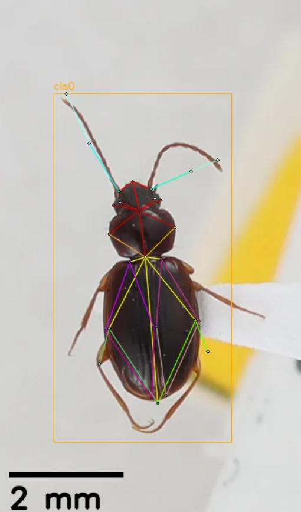

# EXTRAITS

**EXTRA**ct **TRAITS**: morphological measurements of insects from dorsal images.

From a photograph of an insect seen from above, EXTRAITS

1. places **42 keypoints** (head, eyes, thorax, abdomen, antennae, wings, hind legs)
   with an ensemble of YOLO-pose models, and derives **27 measurements** (total length,
   head width, wing length, femur, tibia...);
2. finds the **scale**: a scale bar (detected, then read by OCR) or a ruler (graduation
   spacing by Fourier analysis), to give the measurements in millimetres;
3. says, for each measurement, whether it is **valid** (a leg folded under the body or
   a hidden wing gives a meaningless length), with one classifier per measurement;

and writes one CSV row per image, with a confidence for every value. It works on
Coleoptera, Diptera, Hymenoptera and Lepidoptera, and can be fine-tuned on your own
images.



<sub>Image: <a href="https://huggingface.co/datasets/imageomics/Hawaii-beetles">Hawaii
Beetles</a> (Rayeed et al., 2025, <a href="https://doi.org/10.57967/hf/7272">doi:10.57967/hf/7272</a>),
<a href="https://creativecommons.org/licenses/by/4.0/">CC-BY-4.0</a>; specimen collected by
NEON. Modified: keypoints and measurements added by EXTRAITS.</sub>

## Install

```bash
pip install "extraits @ git+https://github.com/TomBellivier/EXTRAITS"
```

Python 3.10 or later. PyTorch is installed with it; for an NVIDIA GPU, install the
CUDA build of PyTorch first ([pytorch.org](https://pytorch.org/get-started/locally/)).
Extras: `[train]` to train or fine-tune the models, `[annotation]` for the annotation
tools (Label Studio, desktop app).

Or with Docker, without installing anything else ([docs/docker.md](docs/docker.md)):

```bash
docker run --rm -v "$PWD:/workspace" --user "$(id -u):$(id -g)" \
    ghcr.io/tombellivier/extraits process -i /workspace/my_images -o /workspace/results.csv
```

## Quick start

```bash
extraits download-models                        # the official models (~120 MB, once)
extraits process -i my_images/ -o results.csv   # one row per image
extraits analyze -i results.csv                 # figures and summary of the results
```

`download-models` fetches the models from the Hugging Face Hub, at a revision pinned by
this version of EXTRAITS, and checks their checksums. Models and other files go to the
**workspace**, by default the current folder (`--workspace` or `EXTRAITS_WORKSPACE`
to choose another one; [docs/workspace.md](docs/workspace.md)).

Each row of `results.csv` holds, for each measurement, its length in pixels and in
millimetres, its confidence and its validity, plus the scale and the 42 keypoints
([docs/output_columns.md](docs/output_columns.md)). Details and options:
[docs/process.md](docs/process.md).

## Your own images

| Goal | Command | Guide |
|---|---|---|
| Adapt the models to your images (a few dozen annotated images) | `extraits finetune` | [docs/finetune.md](docs/finetune.md) |
| Annotate images (Label Studio, measurement validity, checks) | `extraits annotate` | [docs/annotation.md](docs/annotation.md) |
| Train the pose models or the validity classifiers | `extraits train pose`, `extraits train validity` | [docs/training.md](docs/training.md) |
| Run the whole chain from a settings file | `extraits run` | [docs/training.md](docs/training.md#everything-at-once) |

## The models

| Model | Architecture | Training data | Evaluation |
|---|---|---|---|
| Pose ensemble | 5 × YOLO-pose (Ultralytics `yolo26n-pose`, 640 px), one per cross-validation fold | ~2,500 annotated dorsal images of 4 insect orders | OKS AP 0.810 ± 0.007 on held-out folds |
| Scale-bar detector | YOLO | | |
| Validity classifiers | one random forest per measurement | ~1,200 images with a validity label per measurement | per-measurement MCC and AP: see the model card |

The annotated images come from natural-history collections and cannot be
redistributed: neither they nor the annotations are published. The model card on the
Hub ([TomBellivier/extraits-models](https://huggingface.co/TomBellivier/extraits-models))
gives the details.

## Research

`research/` holds the experiments behind the paper: the other pose approaches compared
with the retained one (per-order models, detect-then-pose, LoRA, per-order batch
normalisation...), the comparison of 8 measurement-validity approaches and the
evaluation of the ruler detector ([research/README.md](research/README.md)).

## Citation

If you use EXTRAITS, please cite it ([CITATION.cff](CITATION.cff)), together with the
GRIT project, the providers of the image databases and Ultralytics YOLO.

<!-- TODO reference of the paper -->

## Licence

- The EXTRAITS **source code** is under the [MIT licence](LICENSE).
- The **models** (weights) and the **Docker images** are under the **AGPL-3.0**: they
  derive from, or bundle, Ultralytics YOLO, which is AGPL-3.0
  ([MODEL_LICENSE.md](MODEL_LICENSE.md)).
- Third-party components keep their own licences
  ([THIRD_PARTY_NOTICES.md](THIRD_PARTY_NOTICES.md)).

## Acknowledgements

EXTRAITS was developed at LIBRe, cE3c (Centre for Ecology, Evolution and Environmental
Changes), Faculdade de Ciências, Universidade de Lisboa, as part of the GRIT project
(Global Repository of Insect Traits; Cardoso et al., 2026,
[doi:10.1111/icad.70035](https://doi.org/10.1111/icad.70035)).

We thank Marija Milicic and Mario Boieiro for validating the annotation protocol, as well as the volunteer annotators (Ana Cerveira, Gabriel Simões, Henrique Miguel, Marija Milicic, Catarina Teixeira, Vasco Lopes, Madalena Barbosa, Tiago Carrapiço). This work obtained funding from the European Union's research and innovation programme Horizon Europe (BioMonitor4CAP, grant agreement #101081964), CE3C (https://doi.org/10.54499/UID/00329/2025), and CHANGE (https://doi.org/10.54499/la/p/0121/2020).  

### Image data

The models were trained on images provided by the following sources. We thank all
of them for making their images available.

- **Hawaii Beetles**: images of ground beetles (Carabidae) by Rayeed et al. (2025),
  [doi:10.57967/hf/7272](https://doi.org/10.57967/hf/7272), CC-BY-4.0, described in
  Rayeed et al. (2026), [arXiv:2601.10687](https://arxiv.org/abs/2601.10687). The
  specimens are NEON vouchers held by the Bernice Pauahi Bishop Museum
  ([NEON biorepository Carabid collection](https://biorepo.neonscience.org/portal/collections/misc/collprofiles.php?collid=97));
  their metadata come from the NEON data product
  [DP1.10022.001](https://data.neonscience.org/data-products/DP1.10022.001) (ground
  beetles sampled from pitfall traps). The dataset was produced with the support of the
  [Imageomics Institute](https://imageomics.org) and the
  [AI and Biodiversity Change (ABC) Global Center](https://www.biodiversityai.org/).
  This material is based in part upon work supported by the U.S. National Ecological
  Observatory Network (NEON), a program sponsored by the U.S. National Science
  Foundation (NSF) and operated under cooperative agreement by Battelle. This material
  uses specimens and/or samples collected as part of the NEON Program.
- **ORBIT project** ([orbitproject.wordpress.com](https://orbitproject.wordpress.com/)),
  led by Paolo Rosa and Denis Michez: images by Max Kasparek, Romain Le Divelec,
  Paolo Rosa, the Biodiversitätszentrum Oberösterreich (OÖ Landes-Kultur GmbH),
  T. J. Wood, Simone Flaminio, V. Radchenko and N. J. Vereecken.
- **Finnish Museum of Natural History (Luomus)**, University of Helsinki: images of
  specimens from its collections, provided directly by the museum.

### Software

The pose and scale-bar models are built on
[Ultralytics YOLO](https://github.com/ultralytics/ultralytics) (Jocher et al., 2026,
[arXiv:2606.03748](https://arxiv.org/abs/2606.03748)); annotation relies on
[Label Studio](https://labelstud.io/). Other third-party components are listed in
[THIRD_PARTY_NOTICES.md](THIRD_PARTY_NOTICES.md).
